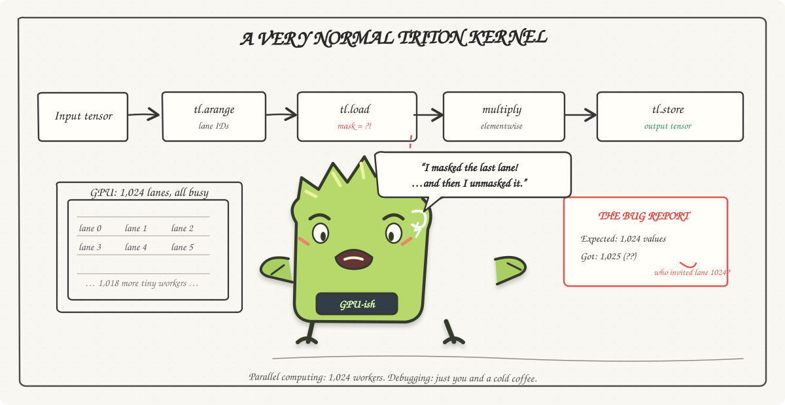

GPU PROGRAMMING RELATED STUFFS HERE

GPU programming: where a typo gets 1,024 coworkers.
The kernel is fast; the debugging is character-building.
One missing mask, and suddenly everyone has opinions.
The CPU said it worked, which was very considerate of it.
Now we stare at the output like it might apologize.
Anyway, the GPU is fine. Probably.
